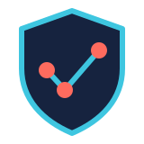
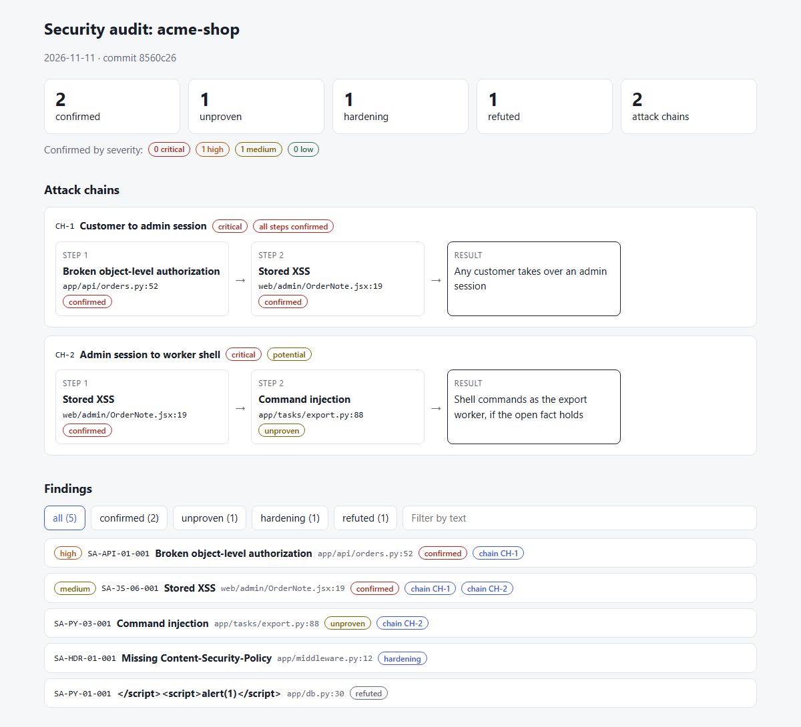

<p align="center"></p>

<h1 align="center">Killchain</h1>

<p align="center">
  <!-- CI -->
  <a href="https://github.com/evandervecht/killchain/actions/workflows/ci.yml">
    
  </a>
  <!-- License -->
  <a href="#license">
    
  </a>
  <!-- Standard -->
  <a href="https://agentskills.io">
    
  </a>
</p>
<p align="center">
  <!-- Agents the skill runs in -->
  
  
  
</p>
<p align="center">
  <!-- Issues -->
  <a href="https://github.com/evandervecht/killchain/issues">
    
  </a>
  <!-- Stars -->
  <a href="https://github.com/evandervecht/killchain/stargazers">
    
  </a>
  <!-- Forks -->
  <a href="https://github.com/evandervecht/killchain/network">
    
  </a>
</p>
<p align="center">
  <!-- Coverage -->
  
  
  
  
</p>

A security auditor for your AI coding agent. The skill finds vulnerabilities in a codebase, has a second agent try to disprove each one, links what survives into attack chains and gives you a dashboard of the result. It covers 15 languages, 26 frameworks, 3 cloud providers, 4 CMS platforms and 2 mobile SDKs, plus Kubernetes, GitHub Actions, GraphQL and AI agents.

It is an [Agent Skill](https://agentskills.io), so it works in Claude Code, Cursor, GitHub Copilot and other agents that support the standard. Forked from [netresearch/security-audit-skill](https://github.com/netresearch/security-audit-skill), which focused on PHP and TYPO3.

<p align="center"></p>
<p align="center"><sub>Demo data.</sub></p>

## What it does

- **Detects the stack** and loads only the references that match it, from 86 reference guides.
- **Scans with 565 checkpoints:** 525 regex checks and 40 review prompts, backed by 552 vulnerable and safe test fixtures.
- **Hunts in parallel:** one agent per area of the project (each service, access control, secrets and dependencies, IaC and CI). Without subagents it reviews the areas one by one.
- **Verifies every finding:** a fresh agent tries to disprove each candidate. Only what survives is `confirmed`; the rest is `unproven`, `hardening` or `refuted`.
- **Scores what is confirmed** with CVSS v4.0.
- **Links attack chains:** findings where one gives the attacker what the next one needs, such as a read bug plus a stored XSS becoming an account takeover.
- **Builds a dashboard:** one HTML file with the verdict counts, the chains step by step and a filterable list of findings. It loads nothing from the network.
- **Checks dependencies in a sandbox:** installs packages in a locked-down Docker container and watches what they do during install.
- **Looks up known CVEs** for findings and dependencies through NVD and OSV.
- **Maps to compliance:** SOC 2, ISO 27001, PCI DSS, HIPAA, GDPR, NIST CSF and the EU AI Act.
- **Checks dependency health:** optional lookup of abandoned, deprecated and relicensed packages through the isitdeadyet.dev MCP server (paid plan).
- **Audits a repository by URL:** clones it and reads it without building or running anything.
- **Vets other agent skills** for prompt injection, hidden instructions and data exfiltration.
- **Runs in your editor too:** MCP server, LSP server, VS Code extension and JetBrains plugin.

## Install

**With the Skills CLI:**

```sh
npx skills add https://github.com/evandervecht/killchain --skill security-audit
```

**From source:**

```sh
git clone https://github.com/evandervecht/killchain.git
```

The skill needs `grep`, `jq` and the `gh` CLI. The dashboard needs Python 3.10 or newer.

## Use

Ask your agent:

```
Audit this project for security vulnerabilities
Check the API endpoints for BOLA vulnerabilities
Score this vulnerability using CVSS v4.0
Audit this AI skill for prompt injection risks
```

Or use a mode:

```
/killchain                        # audit the current project
/killchain target <git url>       # clone another repository and audit it, without running its code
/killchain isitdeadyet            # dependency health through the isitdeadyet.dev MCP server
```

The `isitdeadyet` mode needs a paid [isitdeadyet.dev](https://isitdeadyet.dev) Pro plan and a personal token; without it the skill falls back to its own supply-chain checks.

Or run the scripts yourself:

```sh
./scripts/security-audit-dispatcher.sh /path/to/project                 # scan, stack auto-detected
./scripts/dependency-sandbox.sh pnpm-project ./pnpm-lock.yaml           # install dependencies in the sandbox
./skills/killchain/scripts/github-security-audit.sh owner/repo     # GitHub repository settings
./skills/killchain/scripts/skill-scan.sh ~/.claude/skills/<skill>  # vet an installed agent skill
python3 ./skills/killchain/scripts/dashboard.py findings.json      # build dashboard.html
```

## Documentation

- **Using it:** [Usage](docs/USAGE.md) · [Dependency sandbox](docs/dependency-sandbox.md) · [Editor setup](docs/editor-configs/)
- **Reference:** [Coverage](docs/COVERAGE.md) (every language, framework and platform) · [Finding verification, attack chains and the dashboard](skills/killchain/references/finding-verification.md)
- **How it works:** [Architecture](docs/ARCHITECTURE.md)
- **Contributing:** [Add a language or framework](docs/CONTRIBUTING-REFERENCES.md) · [Security policy](SECURITY.md)

## Roadmap

**Maybe later**, still being thought through:

- **Smaller loads:** one checkpoint file per stack, and each long reference split into a short hunting guide and a longer fixing guide.
- **A coverage list:** what an audit checked, what it skipped and why.
- **More domains:** request smuggling, SAML and passkeys, tenant isolation and data lifecycle, RPC and message brokers, resource exhaustion, C and C++ memory safety.

**Not planned:**

- **Attacking live systems:** the skill reads source and runs local checks. Apart from passive header, TLS and CORS checks, it does not touch deployed services.

## License

| Component | License |
|---|---|
| Code (scripts, workflows, TypeScript/Kotlin packages, configs) | [MIT](LICENSE-MIT) |
| Content (skill definitions, checkpoints, references, docs, evals) | [CC-BY-SA-4.0](LICENSE-CC-BY-SA-4.0) |

## Credits

Forked from [netresearch/security-audit-skill](https://github.com/netresearch/security-audit-skill) by [Netresearch DTT GmbH](https://www.netresearch.de). Extended and maintained by [E van der Vecht](https://github.com/evandervecht).
